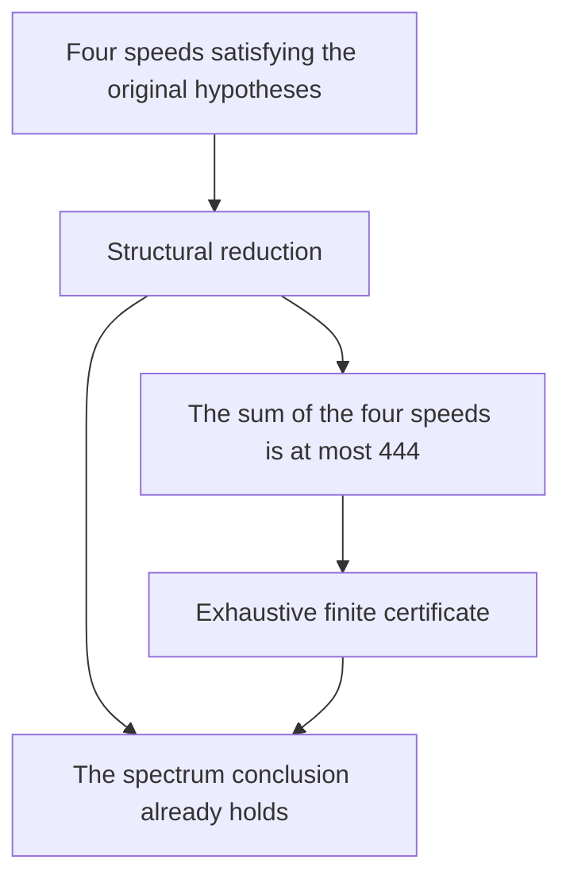

# How the four speed spectrum proof works

Four runners start together on a circular track. At a given time, look at the runner nearest the starting point. How far away can that nearest runner get if we choose the time as well as possible?

Source 5 concerns the possible values of this best simultaneous distance. The proof combines a structural argument for arbitrarily large speeds with a finite certificate covering the remaining cases. Its most transferable idea is to prove that any case still needing attention must be small, then give a separately justified exhaustive check of that small region.

This guide reconstructs the mathematics and selected changes of direction from the saved development notes and formal sources. It is an explanatory account, not an exhaustive transcript. The final argument and the unsuccessful approaches are distinguished below.

## The exact question

For a real number $x$, write $\lVert x\rVert_{\mathbb R/\mathbb Z}$ for its distance to the nearest integer. Thus $\lVert 0.3\rVert_{\mathbb R/\mathbb Z}=0.3$ and $\lVert 0.8\rVert_{\mathbb R/\mathbb Z}=0.2$.

For a finite set of integer speeds $V$, define

```math
L_V(t)=\min_{v\in V}\lVert vt\rVert_{\mathbb R/\mathbb Z},
\qquad
\operatorname{ML}(V)=\max_{t\in\mathbb R/\mathbb Z} L_V(t).
```

The time is **shared by all four runners**. Giving each runner a favorable time of its own does not establish a lower bound for $L_V(t)$.

The hypotheses are that $V$ consists of four distinct positive integers, its collective gcd is 1, and any two distinct speeds have gcd at most 2. The conclusion is

```math
\operatorname{ML}(V)\ge \frac14
\quad\text{or}\quad
\operatorname{ML}(V)=\frac{s}{4s+k}
\quad\text{for integers }1\le k\le4,\ k\le s.
```

This is a restricted four-speed spectrum theorem. It does not prove every version of the Lonely Runner Conjecture, and it does not discard the gcd hypotheses. The exact definition is `Math15.LonelyRunner.Target05` in [CanonicalTarget.lean](../proofs/math15-source05/CanonicalTarget.lean). That file also proves that the supremum defining `ML` is attained, so the informal use of “maximum” is justified.

## A small example that changed the proposed classification

An attractive early conjecture was that every admissible quartet with $\operatorname{ML}<1/4$ would either contain a triple $a,2a,3a$ or belong to the positive family

```math
\lbrace A,B,A+B,A+2B \rbrace.
```

The quartet $V=\lbrace 1,3,4,14 \rbrace$ broke that classification. At $t=7/17$, the four distances are

| Speed | Fractional part of $vt$ | Distance to the nearest integer |
| --- | --- | --- |
| 1 | $7/17$ | $7/17$ |
| 3 | $4/17$ | $4/17$ |
| 4 | $11/17$ | $6/17$ |
| 14 | $13/17$ | $4/17$ |

This gives a lower bound of $4/17$. To prove equality, the formal proof covers the whole time interval $[0,1]$ by nine successive intervals. On each interval, a specified runner is within $4/17$ of an integer. Consequently no time gives all four runners a distance greater than $4/17$.

Both directions are in `exceptionalFourteen_exact` in [Main.lean](../proofs/math15-source05/Main.lean). Nearby declarations verify the quartet's admissibility and its exclusion from the proposed two-family classification.

Yet $4/17=4/(4\cdot4+1)$ is an allowed value. The example refuted an auxiliary classification, not the original theorem. This distinction changed the task: the proof needed room for a bounded remainder instead of forcing every small-distance example into two patterns.

The example also teaches a useful verification habit. A good time proves only a lower bound on a maximum. An exact value requires an upper bound that covers **all** times.

## The architecture of the completed proof

Let $C(V)$ denote the original disjunction about $\operatorname{ML}(V)$. The final assembly uses two theorems:

```math
\begin{aligned}
\text{Every admissible }V &: \quad C(V)\ \text{or}\ \sum_{v\in V}v\le444,\\
\text{Every admissible }V\text{ with }\sum_{v\in V}v\le444 &: \quad C(V).
\end{aligned}
```

The first line is an unbounded mathematical reduction. The second is a complete finite closure. Their hypotheses refer to exactly the same speed set.



The number 444 bounds the **sum** of the speeds. A test of a different region, such as an arbitrary bound on the largest speed, would need a proved coverage relation before it could replace the finite closure.

## Why integer relations help

Put the speeds in a vector $v=(v_1,v_2,v_3,v_4)$. Their simultaneous positions trace the line

```math
t\longmapsto (tv_1,tv_2,tv_3,tv_4)\pmod{\mathbb Z^4}
```

in a four-dimensional torus. Here “torus” simply means that each coordinate wraps around modulo 1. A quarter-distance witness is a point of this line whose four coordinates all lie in $[1/4,3/4]$ modulo 1.

An integer relation is a nonzero integer vector $m$ satisfying

```math
m\cdot v=0.
```

For example, $v_1+v_2=v_3$ gives $m=(1,1,-1,0)$. Such a relation confines the line to a lower-dimensional set. Two independent relations confine it further, allowing the proof to compare the line with a two-dimensional torus.

This representation becomes useful only after the proof supplies quantitative information. It is not enough to observe that integer relations exist.

### Producing the first short relation

If $\operatorname{ML}(V)<1/4$, the final proof constructs a primitive relation $m$ with

```math
0<\sum_i m_i^2\le16,
\qquad
\sum_i |m_i|\le8.
```

“Primitive” means that the gcd of the coefficients is 1. A lattice is a repeating grid of points obtained by taking integer combinations of basis vectors. The construction uses a reduced integer basis, projections, and rounding. Its key comparison is between the all-half point $(1/2,1/2,1/2,1/2)$ and the speed line modulo integer translations. If the line could approximate that point closely enough in all coordinates, it would provide a quarter-distance witness. The assumed failure therefore constrains the reduced basis and yields a short integer normal vector.

The declaration `low_ML_has_primitive_relation_norm_sixteen` proves existence of the relation from primitivity and low `ML`. It does not ask the caller to supply a favorable lattice basis or an unproved approximation assertion.

### Turning two relations into a size bound

The next stage constructs a second relation independent of the first. Independence matters: a multiple of the first relation would add no new constraint.

For independent integer relations $r,s$, define their squared parallelogram area by

```math
A(r,s)=\lVert r\rVert_2^2\lVert s\rVert_2^2-(r\cdot s)^2>0.
```

The relevant theorem, `native_low_two_relations_target_or_sum_bound`, gives either $C(V)$ or

```math
\left(\sum_i v_i\right)^2<784\,A(r,s).
```

The constant has a geometric explanation. The torus argument supplies either the desired spectrum conclusion or a common point with every coordinate at distance at least $2/7$. The margin above $1/4$ is $1/28$. For the actual rank-two lattice, let $D$ be the area of a basic repeating parallelogram. The nearest-line argument bounds the approximation error by $D/(2\lVert v\rVert_2)$. Low `ML` forces that error to exceed $1/28$, yielding $\lVert v\rVert_2<14D$. The inequality $\sum_i v_i\le2\lVert v\rVert_2$ then gives the factor $28^2=784$. The lattice comparison supplies $D^2\le A(r,s)$.

All these objects must belong to the same speed vector and the same integer lattice. A good torus point for one plane and an approximation bound for another cannot be combined.

### Covering the possible coefficients

The bound on $\sum_i|m_i|$ makes the remaining coefficient cases manageable. Write $p=\sum_i|m_i|$. The final reduction has the following outcomes; each row allows the alternative that $C(V)$ already holds.

| Relation case | Bound on the speed sum if still needed |
| --- | --- |
| Even $p$ | 342 |
| $p=3$ | 444 |
| $p=5$ and squared norm at most 11 | 437 |
| The remaining sparse $p=5$ case | 193 |
| $p=7$ | 429 |

For odd $p$, positivity, four distinct speeds, and the relation equation exclude $p=1$; the upper bound 8 leaves 3, 5, and 7. The sparse case forces actual speeds $2q,3q$ with $q\in\lbrace 1,2 \rbrace$, where a separate analytic reduction applies. The largest remaining bound is 444.

These are the cases in `low_small_relation_target_or_sum444`. They use the short relation actually constructed by the proof; this stage does not assume that it minimizes the coefficient sum among all relations.

## What the finite certificate proves

The development included ordinary exact-arithmetic searches. Those searches helped find witnesses and expose false classifications. The final Lean proof does not infer a universal theorem merely because those searches found no counterexample.

Instead, the published file includes data and proofs of their mathematical meaning. At a rational time $t=a/q$, a quarter-distance condition can be expressed using the integer residue of $av$ modulo $q$. A bit mask stores which bounded speeds are supported by one such time.

The crucial operation preserves a **common time**: it finds a mask supporting all four speeds together. The theorem `sharedPacketCover_same_time` supplies this witness, and `sharedPacketCover_ML_ge_quarter` converts it into a lower bound on `ML`. Other cases use already proved structural families.

There are separate obligations:

1. Every supported bit really implies the claimed distance at that mask's time.
2. The cached unions, gcd filters, and bounds agree with their definitions.
3. Every quartet satisfying the original hypotheses and the sum bound is covered by the enumeration.
4. Each covered quartet yields the original conclusion.

The data are split into small checked pieces and assembled. This was important because an earlier large numerical expression exceeded its selected memory limit. Splitting the certificate changed how it was checked, without weakening the mathematical coverage requirement.

The finite theorem is `source05Certificate444FiniteClosure`. The final theorem `source05Certificate444Target` combines it with `source05_native_set_target_or_sum444`, and `Bounty.target` exposes the exact canonical target.

## How the route changed during development

The saved record contains three changes worth remembering.

First, the exceptional quartet defeated the proposed two-family classification. The eventual reduction allowed bounded leftovers, so it did not need that false classification.

Second, an earlier paper route used a hollow zonotope and an external lattice-volume bound. Formalizing that route would have required substantial geometric infrastructure. The final reduction instead constructs the needed short relation through integer bases and rounding. The published file retains some auxiliary declarations from earlier routes, so finding a lemma in the file does not establish that the final theorem depends on it.

Third, some sharper estimates were unnecessary. With a finite endgame covering sum 444, the coarser bounds 437 and 429 already fitted the proof. The final assembly used those bounds rather than requiring every possible improvement. This was a change in what sufficed for the target, not a claim that stronger estimates were false.

The stronger universal conclusion $k\le2$ and a complete classification of all small-distance quartets are not the theorem certified here. The verified target retains $k\le4$.

## Reading the Lean proof

The self-contained [Main.lean](../proofs/math15-source05/Main.lean) is large because it includes both the mathematics and certificate data. Search for these declarations in this order:

| Declaration | What to learn from it |
| --- | --- |
| `source05Certificate444Target` | How the unbounded reduction and finite closure fit |
| `source05_native_set_target_or_sum444` | Transfer from four coordinates to the original finite set |
| `low_small_relation_target_or_sum444` | Complete coefficient case split |
| `low_ML_has_primitive_relation_norm_sixteen` | Construction of the first relation |
| `native_low_two_relations_target_or_sum_bound` | Geometry converted into a size bound |
| `sharedPacketCover_same_time` | Why compressed witnesses still use one time |
| `source05Certificate444FiniteClosure` | Coverage and soundness of the bounded endgame |
| `exceptionalFourteen_exact` | A manageable exact-value proof to study first |

## Lessons to reuse

**Aim for a sufficient reduction.** A complete classification may be much harder than proving “the conclusion holds, or the object lies in this finite region.” Before extending a classification, check what the final theorem actually needs.

**Translate a margin into a bound.** Here the gap between $2/7$ and $1/4$ turns an approximation theorem into a bound on the original speeds. A similar strategy needs both a quantitative margin and a justified comparison with the same object.

**Separate certificate soundness from coverage.** Correct answers for the listed inputs do not prove that all required inputs were listed. Both facts are part of this proof.

**Preserve useful counterexamples.** The quartet $\lbrace 1,3,4,14 \rbrace$ is a compact test for any later attempt to reuse the rejected classification.

Questions for practice: Why does the time $7/17$ alone not prove an exact maximum? Where does the factor 784 enter? What would break if masks combined favorable times independently for different runners? The sections above give the corresponding arguments.

## Evidence and scope

The original complete proof was checked in Lean 4.27.0 with Mathlib v4.27.0 and audited for transitive axioms. The published presentation changes comments only and preserves the original proof payload outside comments, but its complete cleaned file has **not** received a fresh full compilation. The [verification record](../evidence/source05.json) distinguishes those claims.

The historical discussion is a selected reconstruction from the saved Source 5 development and review notes. The linked Lean declarations support the mathematical explanations; these notes do not claim first discovery or an exhaustive history. Mathematical source attribution and reproduction instructions are in the [proof README](../proofs/math15-source05/README.md). For comparison with the tree proof, see [Lessons for future proof work](proof-work-lessons.md).
