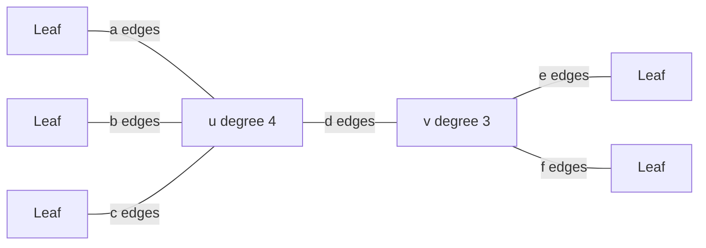

# How the graceful tree proof works

A graceful labeling gives the vertices of a tree distinct integer labels so that the differences across its edges use each number from 1 to the number of edges exactly once. Source 10 proves that such a labeling exists for every tree with one junction of degree 4, another of degree 3, and all other vertices of degree at most 2.

The challenge is to construct labelings that still fit when pieces are joined. A component may be graceful while having the wrong label at its intended attachment vertex. This proof succeeds by tracking that extra information, handling the exceptional cases, and proving that every tree in the statement is covered by the construction.

This is an educational reconstruction from the saved development record and formal sources. It explains the final argument and selected failed attempts, rather than claiming an exhaustive account of discovery.

## The exact question

If a tree has $m$ edges, a graceful labeling is an injective assignment

```math
f:V\longrightarrow\lbrace 0,1,\ldots,m \rbrace
```

such that its edge differences $|f(x)-f(y)|$ are exactly $1,2,\ldots,m$, each once. A tree has $m+1$ vertices, so the vertex labels fill the entire interval as well.

The theorem concerns all finite trees with distinct vertices $u,v$ satisfying

```math
\deg(u)=4,\qquad \deg(v)=3,
\qquad \deg(w)\le2\quad(w\ne u,v).
```

It does not claim that all trees are graceful. The definitions `Branch43` and `Target10` are in [Target10.lean](../proofs/math15-source10/Target10.lean), and [OriginalValidator.lean](../proofs/math15-source10/OriginalValidator.lean) preserves the task definitions under a different namespace.

## Representing every allowed tree

Every tree in the target consists of three terminal paths at $u$, a path from $u$ to $v$, and two terminal paths at $v$. Denote their positive edge lengths by

```math
T(a,b,c;d;e,f).
```



Each drawn connection represents a whole path, possibly a single edge. The total number of edges is $a+b+c+d+e+f$.

Why is this representation exhaustive? A tree has a unique path between its two junctions. Every other edge leaving a junction continues through vertices of degree at most 2 until it reaches a leaf. A cycle would violate the tree hypothesis; disconnected extra pieces would violate connectedness. The formal proof turns this picture into coordinates, positive lengths, and a bijection with the original vertices.

The files [HubStructure.lean](../proofs/math15-source10/HubStructure.lean), [TerminalChoice.lean](../proofs/math15-source10/TerminalChoice.lean), [BridgeChart.lean](../proofs/math15-source10/BridgeChart.lean), and [SixChart.lean](../proofs/math15-source10/SixChart.lean) establish this transfer. The direct edge between the junctions is included; the proof does not silently assume an interior bridge vertex.

## Why a graceful component is not always enough

Suppose two components each admit some graceful labeling. Their labels may collide after joining, their edge differences may overlap, or the new connecting edge may have a difference already used. A useful component theorem therefore needs to record how it can be attached.

An **alpha labeling** is a graceful labeling with a threshold $k$ such that each edge joins a vertex labeled at most $k$ to a vertex labeled above $k$. This permits a controlled shift of all high labels: every old edge difference changes by the same amount.

The proof also tracks the label at a chosen attachment vertex, sometimes called a port. Depending on the construction, that label may need to be 0, 1, 2, or a specified distance from the alpha threshold. Those are actual hypotheses, not interchangeable descriptions of a convenient labeling.

The formal predicate `Complete` in [MatchingLift.lean](../proofs/math15-source10/MatchingLift.lean) records label injectivity, bounds, coverage of all vertex labels, positive edge differences, and unique coverage of every required edge difference. The `Alpha` predicate is in [AlphaTail.lean](../proofs/math15-source10/AlphaTail.lean).

## A bridge construction with an exact matching equation

Take an alpha-labeled component $A$ with $n$ edges, labels $f$, and threshold $0\le k\le n$. Let $B$ have $m$ edges and a complete graceful labeling $g$. To join a vertex $u$ of $A$ to a vertex $v$ of $B$, assign labels as follows:

- Keep the low labels of $A$ unchanged.
- Increase the high labels of $A$ by $m+1$.
- Increase every label of $B$ by $k+1$.

The old differences of $B$ remain $1,\ldots,m$. The old differences of $A$ become $m+2,\ldots,m+n+1$. The missing difference is $m+1$, which the bridge must supply.

If $f(u)\le k$, the precise matching condition is

```math
g(v)+k=f(u)+m.
```

If $f(u)>k$, it is

```math
f(u)=g(v)+k+1.
```

These equations concern the vertices actually joined. Existence of a suitable label somewhere else in either component does not suffice. The theorem `join_complete` in [AlphaJoin.lean](../proofs/math15-source10/AlphaJoin.lean) proves the construction, including that the vertex-label intervals remain disjoint and exhaustive.

A related operation, [amalgamation](../proofs/math15-source10/Amalgamation.lean), identifies suitable vertices of two components rather than adding an edge between them. It has its own label conditions. Keeping those two operations distinct prevents an off-by-one error in both the vertex count and the required differences.

## A worked extension that explains the induction

Here is one of the reusable constructions already proved in the development. Suppose a complete graceful labeling uses $0,\ldots,m$ and an attachment vertex has label 1. Increase all old labels by 2, so that vertex now has label 3. Attach a path of four new edges, with new vertex labels in order

```math
m+4,\quad 0,\quad m+3,\quad 1.
```

The four new edge differences are

```math
m+1,\quad m+4,\quad m+3,\quad m+2.
```

The old edge differences remain $1,\ldots,m$, because translating both endpoints by 2 does not change their difference. The old vertex labels occupy $2,\ldots,m+2$, while the new labels fill the four missing positions. The new endpoint is again labeled 1.

Thus the construction preserves exactly the information needed for another extension. If the old labeling is alpha with threshold $1\le k\le m$, the new one has threshold $k+2$. See `one_tail_complete` and `one_tail_alpha` in [AlphaTail.lean](../proofs/math15-source10/AlphaTail.lean).

This explains why a finite collection of base cases can support arbitrarily long stems: the extension advances the length by four while preserving the attachment condition. [StemInduction.lean](../proofs/math15-source10/StemInduction.lean) checks the base coverage and induction, including the excluded stem length 2 for `onePort_all`. A handful of successful examples without that extension theorem would not establish an unbounded family.

## Matching lifts handle another kind of exception

A second operation replaces each vertex of a smaller certificate by a matched pair. If its old label is $f(x)$ and the old certificate has $m$ edges, assign the pair the labels

```math
2f(x),\qquad 2m+1-2f(x).
```

Edges corresponding to old edges join matching sides of the pairs, so their differences are twice the old differences: precisely the even values. The new edges inside pairs supply the odd differences, each exactly once.

The separation into odd and even values is the mechanism that prevents collisions. `matching_lift` in [MatchingLift.lean](../proofs/math15-source10/MatchingLift.lean) proves all the coverage and uniqueness conditions. A related [singleton lift](../proofs/math15-source10/SingletonLift.lean) leaves the old maximum-labeled vertex unpaired and imposes the corresponding attachment conditions.

These operations supply constructions for the family in which all five terminal arms have length 2, with both odd and even bridge lengths covered. The proof also establishes that the lifted certificates describe the intended tree; the parity argument alone would not prove that identification.

## The failed shortcut that shaped the case split

An early assembly tried to use an alpha labeling of a path with a chosen interior vertex labeled 1. The proposed universal input was too strong: the path with eight edges cannot have the required alpha labeling with its middle vertex labeled 1.

The saved development includes a Lean-checked obstruction, `not_pathOne44`. It reduces the claim to the remaining permutations of the low and high labels and rules them out. That auxiliary obstruction is retained in the local research archive rather than the published dependency bundle. The public proof records the necessary exception explicitly: `pathOne_ordered` in [PathOne.lean](../proofs/math15-source10/PathOne.lean) assumes that the two path lengths are not both 4.

This failure says nothing against ordinary gracefulness of the path or of the target trees. It refutes a particular prescribed-label construction. The repair uses a different attachment label: [CenterTwo.lean](../proofs/math15-source10/CenterTwo.lean) supplies center-two labelings for the exceptional spider family, with suitable stems and separate bridge cases.

Another tempting simplification was to demand a port exactly on an alpha boundary. Some successful extensions instead need a port one position away from that boundary. The useful lesson is to derive the label relation required by the next operation before imposing a stronger preferred condition.

## How all positive lengths are covered

The major split is whether the two arms at $v$ both have length 2.

If $(e,f)\ne(2,2)$, the proof uses a rooted alpha path and a four-legged spider with a selected leaf labeled 0, then amalgamates them. A spider is a tree whose paths meet at one central vertex. These are constructed in the public formal development; they are not unproved paper inputs to the final theorem. See [PathZeroBalanced.lean](../proofs/math15-source10/PathZeroBalanced.lean) and [RegularAssembly.lean](../proofs/math15-source10/RegularAssembly.lean).

If $e=f=2$, the left arms can be permuted to enter one of these cases:

| Left-arm case after a suitable permutation | Construction used |
| --- | --- |
| $c=1$ and $(a,b)\ne(2,2)$ | A short-arm construction and an attachable path |
| $c=2$ and $(a,b)\ne(2,2)$ | A matching-based construction and an attachable path |
| $a=b=c=2$ | The full matching or singleton construction |
| $3\le a\le b\le c$ | Center-one or center-two constructions and marked stems |

The small triple $(1,2,2)$ illustrates why “choose the shortest arm” is not a sufficient rule. Choosing its length-one arm as $c$ leaves the forbidden pair $(2,2)$ for the other operation. Choosing a length-two arm as $c$ leaves $(1,2)$, which fits the second row.

[CaseSelection.lean](../proofs/math15-source10/CaseSelection.lean) proves this coverage for every positive triple. [SixLabeling.lean](../proofs/math15-source10/SixLabeling.lean) assembles the resulting certificates on a common six-path model, including every positive bridge length. The larger-arm case has further explicit exceptions and repairs; it does not silently reinstate the false middle-label-one claim.

## Returning to the original graph

Even a complete labeling of every six-path model would leave a gap if the original graph were never identified with that model. The final transfer uses a particularly useful counting argument.

The construction supplies a bijection onto the vertices of the original tree and maps every certificate edge to an actual tree edge. Let $F$ be the graph formed by those image edges and $G$ the original tree. Then $F\subseteq G$.

The complete certificate has $m+1$ vertices and exactly $m$ distinct edges. Through the vertex bijection, $G$ also has $m+1$ vertices. Since $G$ is a tree, it has exactly $m$ edges. Therefore

```math
F\subseteq G,\qquad \lvert E(F)\rvert=\lvert E(G)\rvert=m
\quad\Longrightarrow\quad F=G.
```

This proves that no graph edges are missing without a separate case-by-case reverse adjacency argument. The theorem is `graceful_of_tree_embedding` in [TreeEmbedding.lean](../proofs/math15-source10/TreeEmbedding.lean).

The conditions are essential. An embedding that omits vertices would not supply the same count, and a target graph with cycles could have extra edges. The shortcut works because the bijection, distinct edge coverage, and tree hypothesis are all available.

## The final assembly and Source 12

The short proof of `source10_verified` in [CanonicalClosure.lean](../proofs/math15-source10/CanonicalClosure.lean) shows the logical order:

1. Derive the path coordinates of the original tree.
2. Choose and permute its terminal arms.
3. Select an applicable construction for the actual lengths.
4. Obtain a complete labeling of the common model.
5. Transport it to the original tree using the vertex bijection and edge-count argument.

[ValidatorBinding.lean](../proofs/math15-source10/ValidatorBinding.lean) then checks the result against the original task definitions, and [Main.lean](../proofs/math15-source10/Main.lean) provides the public entry points.

Source 12 adds the requirement that the two terminal arms at the degree-three junction have length 2. Every Source 12 tree therefore satisfies Source 10's assumptions. The formal implication `target10_implies12` simply uses the general theorem. It is a consequence of the same proof, not an additional independent discovery.

## Lessons to reuse

**Design a component for its consumer.** Record the attachment vertex, its label, the alpha threshold when needed, and the edge differences supplied. Bare existence may omit the information required for composition.

**Use failed prescribed-label claims to change the construction.** The $(4,4)$ obstruction led to a center-two route. It did not require abandoning graceful labelings or pretending the exception disappeared.

**Make extension conditions stable.** The four-edge extension ends with label 1 again. That preserved condition is why it can be repeated, and why the base cases cover an infinite family.

**Look for finite counting arguments at the transfer stage.** When a construction already embeds into the target on the same vertices, an exact edge count may prove equality more simply than direct reverse inclusion.

Questions for practice: Which edge difference does `join_complete` reserve for the bridge? Why does the four-edge extension keep its endpoint usable? Why is an arbitrary spanning subgraph of an arbitrary graph insufficient for the final counting argument? Each answer identifies a hypothesis that future reuse must preserve.

## Evidence and scope

The published proof sources were freshly checked in Lean 4.27.0 with Mathlib v4.27.0. The publication check covered 71 source files and audited 607 named declarations, with only the standard axioms `propext`, `Classical.choice`, and `Quot.sound`. The [verification record](../evidence/source10.json) binds the checked source and dependency files.

The construction history above draws on the saved Source 10 development note and the inspected auxiliary obstruction. It is a selected history, not a claim that every experiment has been published. Source attribution and reproduction instructions are in the [proof README](../proofs/math15-source10/README.md). See also [Lessons for future proof work](proof-work-lessons.md).
